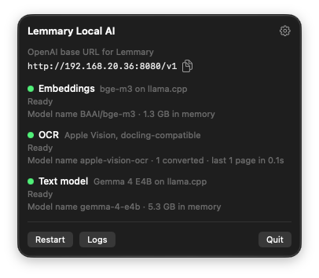
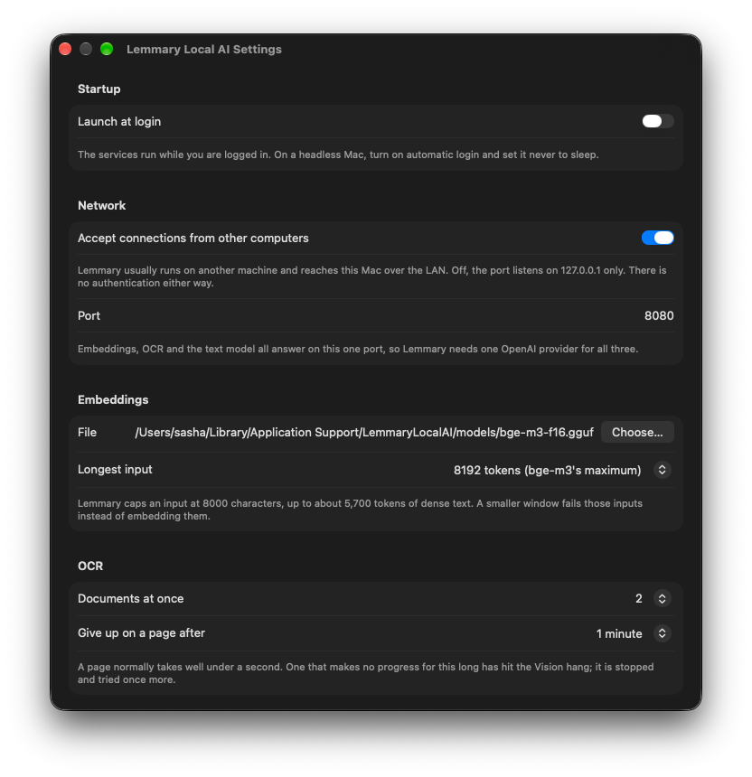
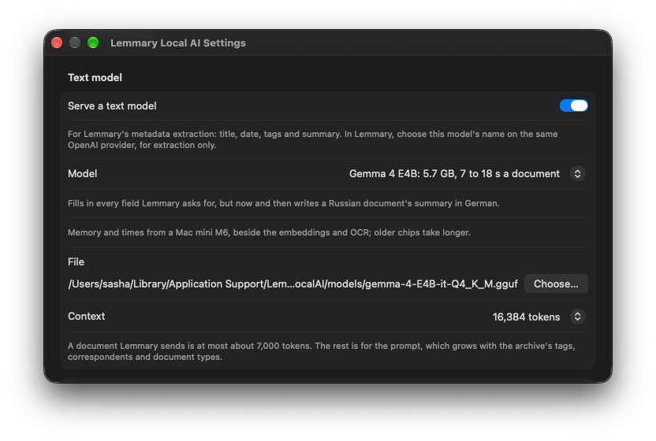

# Lemmary Local AI

A macOS menu bar app that serves [Lemmary](../lemmary)'s local embeddings and
local OCR from an Apple Silicon Mac, and optionally a small text model for
Lemmary's metadata extraction. It replaces the hand-built setup in Lemmary's
`docs/local_ai_macos.md`: three LaunchAgents, Homebrew's llama.cpp, a 2 GB
Python environment for docling-serve, an ocrmac patch and a watchdog script.



All three answer on one port, 8080, so Lemmary needs one provider for them:

| | Embeddings | OCR | Text model (optional) |
|---|---|---|---|
| Engine | `llama-server` (llama.cpp, Metal), bundled | Apple Vision `RecognizeDocumentsRequest` | a second `llama-server` |
| Model | `BAAI/bge-m3`, F16 GGUF, downloaded and checksummed on first run | built into macOS | one of five 4-bit GGUFs, the larger ones on a Mac with 24 or 32 GB, downloaded and checksummed when turned on |
| Model name in Lemmary | `BAAI/bge-m3` | `apple-vision-ocr` | `gemma-4-e4b`, or the one chosen |
| API | OpenAI `/v1/embeddings` | OpenAI `/v1/chat/completions` with the document attached, or docling-serve's `POST /v1/convert/file` | OpenAI `/v1/chat/completions` |

Lemmary needs no change: its OpenAI provider type reaches all three at
`http://<mac>:8080/v1`, and its `local` embeddings and `docling` OCR types
still work against the same port. The embeddings model's name is the one its
guide already uses, so nothing needs re-embedding.

## Requirements

- Apple Silicon, macOS 26 or newer (Vision's document reader is new in 26).
- About 1.5 GB of memory for embeddings (mostly the model) and 0.1 to 0.3 GB
  per OCR worker. The text model adds 5.7 to 18.7 GB, depending on the
  model; Settings offers the larger ones only on a Mac with 24 or 32 GB. With
  everything on and Gemma 4 E4B, a 16 GB Mac still had about half its memory
  free.
- To build: Xcode 26 or newer.

## Install

Download `LemmaryLocalAI-macOS-arm64.zip` from the latest
[release](https://github.com/buldezir/lemmary-local-ai/releases), unzip it and
drag `LemmaryLocalAI.app` into Applications before you open it: macOS runs an
app opened where it was downloaded from a temporary copy, which can't update
itself (`xattr -dr com.apple.quarantine /Applications/LemmaryLocalAI.app`
fixes one that says it can't be updated). A release is signed with Developer
ID, notarized, and updates itself: **Check for Updates…** is in the menu bar
panel, and Settings turns the daily checks and automatic installs on and off.
Embeddings, OCR and the text model stop for a few seconds while it updates.

Or build it on the Mac that runs it:

```bash
Scripts/release.sh --install       # builds /Applications/LemmaryLocalAI.app
open /Applications/LemmaryLocalAI.app
```

That build is ad hoc signed for this Mac only, with version 0.1 and the commit
as its build number, and doesn't update itself; installing it over a release
replaces the copy that would have.

The menu bar icon opens a panel with the URL to give Lemmary (with a copy
button), the services, their model names and their state. On first launch it asks for the
embeddings model: **Download** fetches bge-m3 (1.16 GB) and verifies its
SHA-256, or **Use Existing File…** points at a GGUF you already have, such as
`~/ai/models/bge-m3-f16.gguf` from the old setup.

Turn on **Launch at login** in Settings. Like the LaunchAgents it replaces, it
runs in a logged-in session: on a headless Mac, enable automatic login and
never sleep.

### In Lemmary

Add one provider of type **OpenAI**:

- base URL: the one the panel shows, e.g. `http://<mac>:8080/v1`
- API key: anything. Lemmary refuses an empty one; this app checks none.

Then choose its models per job: `BAAI/bge-m3` for embeddings,
`apple-vision-ocr` for OCR, and the text model's name (see
[Text model](#text-model)) for extraction only. Lemmary's pickers list them
from `GET /v1/models`, where each model says what it is for:

| Model | `purposes` | `capabilities` | `context_length` |
|---|---|---|---|
| `BAAI/bge-m3` | `["embedding"]` | `embeddings` | the embeddings context, 8192 |
| `apple-vision-ocr` | `["ocr"]` | `ocr` | none |
| the text model, while it is on | `["llm"]` | `completion_chat` | the text model's context, 16,384 |

`purposes` uses Lemmary's own names for the jobs, and `capabilities` is
Mistral's object (`completion_chat`, `ocr`) with an `embeddings` flag beside
them. Lemmary reads both only for some provider types today, so until it reads
`purposes` its chat and OCR pickers offer both of those models; any can be
chosen by name. `GET /v1/models/{id}` answers for one model. The OCR model reads the PDF or
image Lemmary attaches, whatever the prompt says; a password-protected PDF
comes back as an error with that reason.

Lemmary's other two types work against the same port, for an install that
already has them: a `local` embeddings provider at `http://<mac>:8080/v1`, and a
`docling` OCR provider at `http://<mac>:8080`.

### Moving from the LaunchAgent setup

The app takes port 8080, the embeddings service's, so stop the old services
first:

```bash
launchctl bootout gui/$(id -u)/<prefix>.docling-watchdog
launchctl bootout gui/$(id -u)/<prefix>.docling-serve
launchctl bootout gui/$(id -u)/<prefix>.llama-embeddings
```

In Lemmary, the embeddings provider can stay as it is; point the docling
provider at `http://<mac>:8080`, or replace both with the one OpenAI provider
above. Embedding vectors are identical to the Homebrew llama-server's (same
model file, cosine 1.000000), so nothing needs re-embedding. OCR text comes
from Vision instead of docling's layout models; documents already processed
keep their text.

### Moving from three ports

Before everything moved to one port, OCR answered on 5001 and the text model on
8081; neither is open any more. Point a `docling` provider at
`http://<mac>:8080` and the text model's provider at `http://<mac>:8080/v1`, or
replace all three with the one OpenAI provider. A changed embeddings port
becomes the one port.

## Settings



| | Default | |
|---|---|---|
| Accept connections from other computers | on | off binds the port to 127.0.0.1 |
| Port | 8080 | embeddings, OCR and the text model; the llama-servers behind it are on loopback |
| Longest input | 8192 tokens | 6144 uses less memory but fails Lemmary's longest inputs |
| Documents at once | 2 | one warm OCR worker process per document |
| Give up on a page after | 60 s | a page normally takes 0.1 to 0.3 s |
| Serve a text model | off | |
| Text model | Gemma 4 E4B | or a larger one, by the Mac's memory; see below |
| Text model context | 16,384 tokens | 32,768 costs 0.3 to 0.6 GB more |

Any setting can be overridden for one run, which is how a second copy runs
beside an installed one:

```bash
Scripts/dev.sh --run -Port 18080 -ModelPath ~/ai/models/bge-m3-f16.gguf
```

A copy started from `.build` shares the installed app's settings (same bundle
identifier), so change its settings this way, not in its Settings window.

Logs are in `~/Library/Logs/LemmaryLocalAI/`: `llama-server.log`,
`text-model.log`, and `ocr.log` with one line per document.

## Text model

Turn on **Serve a text model** in Settings, pick the model, and press **Apply
and Restart Services**; the menu bar panel then offers the download (5.0 to
17.7 GB, checked against its SHA-256). Settings offers the models by the Mac's
memory, and a choice carried over from a bigger Mac falls back to Gemma 4 E4B:

| Memory | Models |
|---|---|
| any | Gemma 4 E4B (default), Ornith 1.5 9B |
| 24 GB or more | also Gemma 4 12B and Gemma 4 26B-A4B |
| 32 GB or more | also Qwen3.6 35B-A3B |



In Lemmary, choose the model name the panel shows on the OpenAI provider
([In Lemmary](#in-lemmary)): `gemma-4-e4b`, `ornith-1.5-9b`, `gemma-4-12b`,
`gemma-4-26b-a4b` or `qwen3.6-35b-a3b`. Any other name, except
`apple-vision-ocr`, also reaches whichever model Settings has chosen.

Use it for extraction (title, date, type, correspondent, tags, suggested tags,
summary) and keep chat and Deep Search on a hosted model: a model this size is
weak at tool use and long conversations.

All five were run on Lemmary's own extraction prompt and client, next to the
embeddings and OCR, on a Mac mini M6 with 32 GB: 14 German and Russian
documents (invoices, letters, a lease, a tax assessment, insurance, bank
statements up to Lemmary's 24 KB limit), then the four longest again while
embeddings and two OCR streams ran without a pause:

| | Gemma 4 E4B (default) | Ornith 1.5 9B | Gemma 4 12B | Gemma 4 26B-A4B | Qwen3.6 35B-A3B |
|---|---|---|---|---|---|
| File | Q4_K_M, 5.0 GB | Q4_K_M, 5.8 GB | QAT Q4_K_XL, 6.7 GB | QAT Q4_K_XL, 14.2 GB | IQ4_XS, 17.7 GB |
| A document | 7 to 18 s | 8 to 32 s | 13 to 49 s | 5 to 19 s | 6 to 22 s |
| Slowest under load | 36 s | over 90 s | 86 s | 40 s | 56 s |
| Memory | 5.7 GB | 6.9 GB | 9.3 GB | 16.2 GB | up to 18.7 GB |
| Summaries in the document's language | 12 of 14 | 13 of 14 | 14 of 14 | 14 of 14 | 13 of 14 |
| References | as asked | one missed, one customer number | one tax number | as asked | account and customer numbers in 7 documents |
| Fields | every one asked for | 4 documents without `suggested_tags` or `references` | every one | every one | every one |

Gemma 4 26B-A4B and Qwen3.6 35B-A3B are mixtures of experts, which read 3 to
4B of their weights per token: that is why they are faster than the 12B. Qwen
gave the most detailed summaries and matched existing correspondents best;
Gemma 4 26B-A4B is the one to pick where it fits. On a 24 GB Mac it leaves
little memory for anything else: macOS took about 5 GB, the embeddings and OCR
2.3. Every model now and then translated the archive's German tags on a
Russian document or mixed scripts in a word ("Кontoauszug"), and Lemmary drops
a tag that is not in the archive.

On a Mac mini M4 with 16 GB, earlier, Gemma 4 E4B took 9 to 25 s a document
and 5.4 GB, Ornith 1.5 9B 10 to 45 s and 6.3 GB; there Ornith wrote the most
useful titles ("Stromrechnung Stadtwerke Musterstadt Nr. 2024-4711") and E4B
bare ones on invoices ("Rechnung").

Qwen3.5 4B and 9B and Granite 4.2 8B were tried too and did worse: summaries
in the wrong language, made-up tags, and Granite took up to a minute and 9 GB.
Apple's built-in model costs no memory but does not support Russian.

The service reads one document at a time and queues the rest. Lemmary's
worker sends one at a time and allows 90 s (`AI_TIMEOUT_SEC`); if several
Lemmary instances share this Mac, raise that. While it reads a document,
embeddings slow down (a 64-text batch took 18 s instead of 4; a search query
200 ms instead of 20), and OCR about doubles; nothing fails.

## OCR compared with docling-serve

Measured on a Mac mini M4, warm:

| | docling-serve 1.35 + ocrmac | this app |
|---|---|---|
| One invoice page | 2 to 4 s | 0.2 s |
| 10-page scanned PDF | 6.0 s | 2.1 s |
| Memory | 1.5 to 3.9 GB | 0.1 to 0.3 GB per worker |
| On disk | 2.6 GB | part of macOS |

Text, amounts, IBANs and umlauts came out the same on the test invoices. The
first document of some kinds costs a one-off 12 seconds in each worker while
Vision loads a further model; after that it is 0.2 s.
docling's table model lines up borderless tables better; Vision keeps every
value but sometimes merges or shifts cells. Vision also drops some short
isolated tokens, such as a lone "Q1" in a table's first column. PPTX and XLSX
are refused (Lemmary extracts XLSX itself); DOCX and HTML are converted as text.

## Releases

`.github/workflows/build.yml` builds releases only: a `v*` tag, or a run by
hand. Pushes to `main` and pull requests build nothing. It runs on GitHub's
Apple silicon `xcode-27` runner, builds the app with `Scripts/release.sh`,
uploads it, then runs `swift test --no-parallel`; the release job publishes
only after the tests pass.

- The tag sets the version, and a build number that only grows
  (`0.3.0-beta.2` → 30002, `0.3.0` → 30099), which Sparkle compares;
  `bundle.sh` takes them as `VERSION` and `BUILD`. A local build is version
  `0.1`, with the commit as its build, and doesn't update.
- `bundle.sh` signs every binary in the app (`IDENTITY`) with the Developer ID
  certificate in the repository's secrets (`MACOS_CERTIFICATE_P12_BASE64`,
  `MACOS_CERTIFICATE_PASSWORD`): llama-server and its dylibs, ocr-worker,
  Sparkle's helpers (`Scripts/sign-sparkle.sh`) and the app, with the hardened
  runtime and a secure timestamp. The workflow notarizes it with an App Store
  Connect API key (`NOTARY_API_KEY_BASE64`, `NOTARY_API_KEY_ID`,
  `NOTARY_API_ISSUER_ID`) and staples the ticket. An ad hoc build goes without
  the runtime, whose library validation would stop it loading
  Sparkle.framework.
- `Scripts/appcast.sh` writes the app's Sparkle feed,
  `LemmaryLocalAI-macOS-appcast.xml`: the zip's EdDSA signature
  (`SPARKLE_PRIVATE_KEY`, checked against the app's `SUPublicEDKey`) and the
  release's notes up to its `## Downloads`, if the release is written by then.
  The release job uploads the zip and `SHA256SUMS`, then the feed, which
  `SUFeedURL` reads from the latest release.
- A tag without the secrets fails. A run by hand takes a `version`, such as
  `0.2.0-test.1`, to build an app that offers and takes updates, and a
  `bundle_id`, such as `eu.buldezir.lemmary-local-ai.updatetest`, to keep it
  apart from the installed one.

The app updates itself with Sparkle (`AppUpdater`). `bundle.sh` copies
Sparkle.framework into the app, where the binary finds it through
`@executable_path/../Frameworks`; the helpers it starts never load it.
Sparkle installs only updates signed with the key whose public half is
`SUPublicEDKey` in `Resources/Info.plist`. Its private half is in the login
keychain of the Mac mini that serves Lemmary (account `lemmary-local-ai`) and
belongs in the repository's secrets; keep a backup, since without it the app
can never update again:

```bash
swift build                                  # fetches Sparkle's tools into .build/artifacts
sparkle=.build/artifacts/sparkle/Sparkle/bin
$sparkle/generate_keys --account lemmary-local-ai -p      # prints the public key
$sparkle/generate_keys --account lemmary-local-ai -x private-key
gh secret set SPARKLE_PRIVATE_KEY < private-key && rm private-key
```

## How it works

See [AGENTS.md](AGENTS.md).

## License of bundled components

`llama-server` and its libraries are llama.cpp's, MIT-licensed; the license is
in the app at `Contents/Resources/llama.cpp-LICENSE`.
